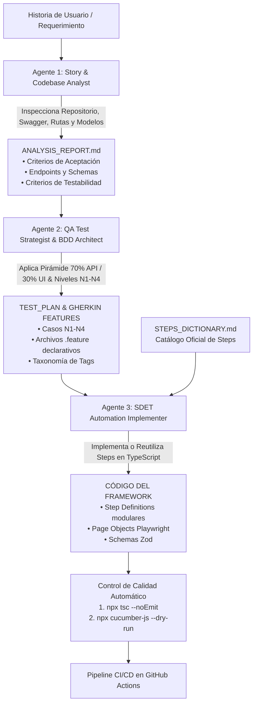

# 🤖 Orquestador del Pipeline de QA Multi-Agente End-to-End

> **Inspirado en la Arquitectura de Sergio Cañete Linares:** Ecosistema de agentes de IA para el ciclo de vida continuo de pruebas guiado por especificaciones (*Spec-Driven Development*).  
> **Objetivo:** Transformar una Historia de Usuario (HU) en pruebas automatizadas ejecutables en TypeScript + Playwright + Cucumber BDD con validación de contratos, cero steps huérfanos y máxima velocidad.

---

## 🔄 Flujo de Trabajo del Pipeline (De Requisito a Código Ejecutable)

---

## 👥 Definición de los Tres Agentes del Pipeline

| Agente | Nombre | Rol y Misión | Artefacto de Entrada | Artefacto de Salida | Archivo de Especificación |
|---|---|---|---|---|---|
| **Agente 1** | **Story & Codebase Analyst** | Analiza la HU y examina el código fuente del repositorio (rutas Express, modelos Mongo, Swagger, componentes React) para detectar requisitos implícitos y criterios de testabilidad. | Historia de Usuario en lenguaje natural / Jira | `ANALYSIS_REPORT.md` | [01-story-and-code-analyst.md](./agents/01-story-and-code-analyst.md) |
| **Agente 2** | **QA Test Strategist & BDD Architect** | Diseña la estrategia de prueba bajo la pirámide 70% API / 30% UI (niveles N1-N4) y redacta los escenarios Gherkin declarativos de negocio. | `ANALYSIS_REPORT.md` | `INCREMENTAL_TEST_PLAN.md` y archivos `.feature` | [02-qa-test-planner.md](./agents/02-qa-test-planner.md) |
| **Agente 3** | **SDET Automation Implementer** | Conoce el framework en profundidad. Consulta [STEPS_DICTIONARY.md](../../STEPS_DICTIONARY.md) para reutilizar steps existentes, implementa nuevos steps sólo si es necesario, actualiza Page Objects y valida compilación y dry-run. | Archivos `.feature` + `STEPS_DICTIONARY.md` | Código TypeScript (`src/`, `tests/`) | [03-sdet-implementer.md](./agents/03-sdet-implementer.md) |

---

## 🚀 Cómo Ejecutar el Pipeline en Antigravity

Para ejecutar el pipeline sobre una nueva funcionalidad o historia de usuario, invoca a los agentes secuencialmente en el prompt:

### Fase 1: Análisis de Requisitos y Código
> *"Actúa como el **Agente 1 (Story & Codebase Analyst)** siguiendo `.agents/pipeline/agents/01-story-and-code-analyst.md`. Analiza la siguiente Historia de Usuario e inspecciona el repositorio: [Pega aquí la HU]."*

### Fase 2: Estrategia y Redacción BDD
> *"Actúa como el **Agente 2 (QA Test Strategist)** siguiendo `.agents/pipeline/agents/02-qa-test-planner.md`. Toma el informe del Agente 1 y genera el plan de pruebas 70/30 y los archivos `.feature` en Gherkin declarativo."*

### Fase 3: Implementación y Validación SDET
> *"Actúa como el **Agente 3 (SDET Automation Implementer)** siguiendo `.agents/pipeline/agents/03-sdet-implementer.md`. Toma las features del Agente 2, consulta `STEPS_DICTIONARY.md` para reutilizar steps, implementa el código en TypeScript y valida con `tsc` y `cucumber-js --dry-run`."*
