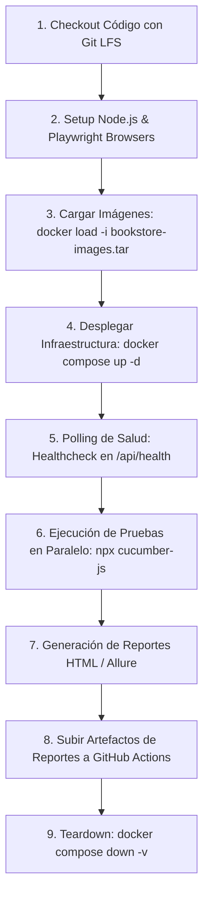

# 🚀 Estrategia de CI/CD para Docker Local y Ejecución Paralela

Este documento detalla la solución arquitectónica diseñada por **Sergio Cañete Linares** para resolver la restricción crítica planteada en las instrucciones del reto:

> *"El entorno se entrega únicamente como imágenes Docker dentro del archivo `bookstore-images.tar` y no está publicado en ningún registro. No publiques el paquete ni las imágenes en repositorios o registros públicos. Decide cómo disponibilizar el entorno dentro de tu pipeline y documenta en tu README.md la solución elegida, sus limitaciones y las alternativas que consideraste."*

---

## 🧐 Análisis de Alternativas de Disponibilización

| Alternativa | Descripción | Pros | Contras / Limitaciones | Decisión |
|---|---|---|---|---|
| **1. Docker Registry Público (Docker Hub / GHCR)** | Subir las imágenes a un registro accesible por internet. | Facilidad extrema en el pipeline (`docker pull`). | ❌ **PROHIBIDO EXPRESAMENTE** por las instrucciones del reto (filtración de propiedad intelectual). | **Descartada** |
| **2. Registro Privado (GHCR / AWS ECR) con Tokens** | Subir las imágenes a un registro privado autenticado con `GITHUB_TOKEN`. | Aislamiento seguro, descargas rápidas en CI. | Requiere que los evaluadores configuren credenciales privadas o permisos de organización que no siempre tienen. | **Descartada como solución base** |
| **3. Git LFS / Commit en el Repositorio de Pruebas** | Almacenar `bookstore-images.tar` en el repositorio mediante Git LFS (Large File Storage) o commit directo. | Autocontenido: cualquier persona que clone el repo puede ejecutar tanto en local como en GitHub Actions sin configurar nada externo. | Aumenta el tamaño del clonado inicial del repositorio (~89 MB). | **Recomendada para Evaluación Directa** |
| **4. GitHub Actions Cache (`actions/cache`)** | Cachear las imágenes de Docker tras el primer `docker load` basándose en el hash de `docker-compose.yml` o del tarball. | Reduce drásticamente los tiempos de compilación/carga en ejecuciones subsecuentes del runner. | Requiere que la primera ejecución cargue el tarball. | **Estrategia Híbrida Recomendada** |

---

## 🛠️ Arquitectura del Pipeline en GitHub Actions

### Diagrama de Flujo del Job de CI



---

## 🛡️ Healthcheck Activo y Resiliencia en CI

En entornos CI (runners virtuales de GitHub Actions), `docker compose up -d` retorna inmediatamente, pero los contenedores (MongoDB, Node API, React UI) tardan entre 10 y 25 segundos en iniciar, realizar las migraciones y sembrar la base de datos.

Si las pruebas arrancan antes de que el backend responda, fallarán con `ECONNREFUSED`.

### Script de Espera Activa (Polling Robusto):
```bash
echo "Esperando a que la API responda en http://localhost:5000/api/health..."
MAX_RETRIES=30
RETRY_COUNT=0

until curl -s -f http://localhost:5000/api/health | grep -q "ok" || [ $RETRY_COUNT -eq $MAX_RETRIES ]; do
  echo "La API aún no está lista. Reintentando en 2s... ($RETRY_COUNT/$MAX_RETRIES)"
  sleep 2
  RETRY_COUNT=$((RETRY_COUNT + 1))
done

if [ $RETRY_COUNT -eq $MAX_RETRIES ]; then
  echo "Error: La API no alcanzó estado healthy a tiempo. Logs del backend:"
  docker compose logs backend
  exit 1
fi

echo "¡API y Base de Datos operativas! Iniciando ejecución de pruebas."
```

---

## ⚡ Ejecución Paralela y Reportabilidad

1. **Paralelismo Seguro**:
   - Para maximizar el rendimiento sin colisionar datos, Cucumber ejecuta escenarios en paralelo (`--parallel 4`).
   - Cada escenario genera su propio identificador único para libros o usuarios (usando `faker.string.uuid()`).
   - Los tests de UI corren en navegadores sin cabeza (*headless*) usando múltiples workers de Playwright.

2. **Gestión de Artefactos**:
   - En caso de fallo en UI, el hook de Playwright adjunta automáticamente:
     - Pantallazo PNG del estado de la pantalla.
     - Playwright Trace `.zip` (para inspección interactiva en `trace.playwright.dev`).
   - El pipeline archiva el reporte HTML unificado mediante `actions/upload-artifact@v4`.
