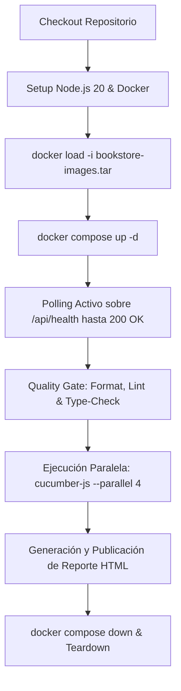

# 📋 Informe de Arquitectura y Revisión Técnica para Expertos SDET / QA Architects

> **Proyecto:** BookStore QA Sandbox — Desafío Técnico de Automatización (LogNext - Verisure)  
> **Autor / Arquitecto:** Sergio Cañete Linares (*Senior QA Automation Engineer / SDET & AI Test Automation Architect*)  
> **Fecha:** Octubre 2026  
> **Propósito del Documento:** Presentar el contexto, los requisitos originales, las decisiones técnicas de diseño y el estado actual de la solución para su revisión por pares (*Peer Review*), recabando sugerencias de mejora o dictamen de aprobación técnica.

---

## 🎯 1. Contexto y Requerimientos de Entrada (Lo que necesitábamos hacer)

### 1.1. El Sistema Bajo Prueba (SUT)
El desafío técnico consiste en automatizar las pruebas integrales de una aplicación corporativa de gestión de catálogo de libros (**BookStore QA Sandbox**), compuesta por:
- **Backend API:** Servicio REST en Node.js/Express escuchando en el puerto `5000` (`http://localhost:5000/api`), con endpoints de autenticación (`/api/auth/login`, `/api/auth/register`), gestión de catálogo (`/api/books`, `/api/books/:id`) y sonda de salud (`/api/health`).
- **Frontend Web:** Aplicación cliente en React escuchando en el puerto `3000` (`http://localhost:3000`), con vistas de Login (`/login`), Registro (`/register`) y Catálogo interactivo (`/books`) con modales de alta/edición/confirmación y tablas dinámicas.
- **Base de Datos:** MongoDB 7 en el puerto `27017` con usuarios y catálogo pre-semillados.

### 1.2. Requisitos Mandatorios y Restricciones de Ingeniería
1. **Stack Tecnológico Obligatorio:** Implementación en **Playwright + TypeScript + Cucumber BDD**, configurado con tipado estricto y sin uso de librerías obsoletas.
2. **Pirámide de Pruebas Estricta (70% API / 30% UI):**
   - 70% del esfuerzo y cobertura centrado en la capa de servicios REST: validación de contratos OpenAPI, esquemas de datos, control de autenticación JWT, operaciones CRUD y códigos de error normalizados.
   - 30% restante enfocado en recorridos críticos de UI: inicio de sesión, apertura de modales, alta interactiva, eliminación en tablas y flujos híbridos E2E.
3. **Restricción Crítica de Seguridad y Confidencialidad:**
   - La entrega del entorno se realiza en un archivo empaquetado `bookstore-images.tar`.
   - **Queda terminantemente prohibido publicar o subir estas imágenes a registros públicos de contenedores** (Docker Hub, GHCR, etc.). Todo el ciclo de CI/CD debe operar en modo hermético/air-gapped extrayendo las imágenes con `docker load -i bookstore-images.tar`.
4. **Filosofía Arquitectónica: Máxima Abstracción en "Piezas de Puzzle" (Lego Architecture):**
   - El evaluador exigió expresamente una arquitectura inspirada en la experiencia senior con Cucumber y Java: **cero pasos redundantes y cero pasos acoplados a una página o endpoint específico**.
   - Si mañana se introduce un nuevo microservicio (ej. `/api/users`, `/api/devices`) o una nueva pantalla, el equipo QA debe poder escribir y ejecutar pruebas completas en Gherkin **sin necesidad de programar nuevas clases Page Object ni nuevos step definitions en TypeScript**.
5. **Aislamiento y Teardown Garantizado:**
   - Cada escenario debe generar sus propios datos (evitando colisiones con libros semilla) y eliminarlos automáticamente en el teardown (hook `After`).
6. **Integración de Agentes de IA en el Ciclo de Vida QA:**
   - Diseño de un pipeline de 3 agentes autónomos (Analista de Historias/Código, Planificador QA e Implementador SDET) guiados por un diccionario de steps gobernado ([STEPS_DICTIONARY.md](file:///c:/Users/PC/Documents/LogNext-Verisure/STEPS_DICTIONARY.md)).

---

## 🏗️ 2. Decisiones Técnicas y Solución Implementada (Lo que hemos hecho y cómo)

### 2.1. Erradicación de Steps de Dominio y Consolidación en 4 Motores Universales
En frameworks BDD convencionales, la práctica habitual es crear archivos acoplados al dominio de negocio (`auth.steps.ts`, `books.steps.ts`, `login-ui.steps.ts`, `books-ui.steps.ts`). Tras la auditoría arquitectónica inicial, **se eliminaron completamente dichos archivos** para evitar colisiones de Cucumber y duplicidad de código.

La arquitectura se consolidó en **4 únicos motores agnósticos**:
```
tests/step-definitions/
├── api/
│   ├── atomic-api.steps.ts   # Peticiones HTTP universales, mutación JSONPath y aserciones de campo
│   └── common-api.steps.ts   # Códigos de estado HTTP, contratos Zod OpenAPI y envelope de errores
└── ui/
    ├── atomic-ui.steps.ts    # Acciones agnósticas en páginas, modales, tablas, alertas y sesión
    └── common-ui.steps.ts    # Navegación básica, validación de URLs y textos genéricos
```

---

### 2.2. Motor Atómico de API y Motor Universal JSONPath
Para posibilitar que cualquier endpoint sea probado sin DTOs estáticos ni steps acoplados, se diseñó e implementó:

1. **Motor Nativo JSONPath ([src/support/jsonpath.ts](file:///c:/Users/PC/Documents/LogNext-Verisure/src/support/jsonpath.ts)):**
   - Módulo tipado en TypeScript con cero dependencias externas.
   - Soporta normalización de rutas (`$.path`, `path`, notación de corchetes `[0]`), resolución segura (`getJsonPath`), mutación profunda (`setJsonPath`) y borrado (`deleteJsonPath`).
2. **Preparación y Mutación Dinámica de Payloads en Gherkin:**
   Permite definir una plantilla JSON base y alterar campos específicos en pasos consecutivos:
   ```gherkin
   When the user prepares a JSON payload:
     """
     {
       "title": "Clean Architecture",
       "author": "Sergio Cañete",
       "isbn": "{{random_isbn}}",
       "price": 29.99,
       "category": "Engineering"
     }
     """
   And the user sets JSONPath "$.price" to the number 45.00
   And the user removes JSONPath "$.category"
   And the user sends a "POST" request to "/books" with the prepared payload
   Then the response status code should be 201
   ```
3. **Encadenamiento de Datos sin Variables Hardcodeadas:**
   Cualquier propiedad de la respuesta puede capturarse y reutilizarse dinámicamente en peticiones posteriores mediante variables de plantilla (`{{alias}}`):
   ```gherkin
   When the user saves the response JSONPath "$.id" as "createdId"
   And the user sends a "GET" request to "/books/{{createdId}}"
   Then the response JSONPath "$.price" should equal the number 45.00
   ```
4. **Desacoplamiento Total de Contratos con `SchemaRegistry` ([src/api/schemas/registry.ts](file:///c:/Users/PC/Documents/LogNext-Verisure/src/api/schemas/registry.ts)):**
   - En lugar de sentencias `switch` con nombres de esquemas fijos, se implementó un registro dinámico en el que los esquemas Zod se registran al inicio.
   - El step `Then the response should match the "{schemaName}" contract` consulta el registro dinámicamente, garantizando que agregar nuevos esquemas en el futuro no requiera modificar los steps.

---

### 2.3. Motor Atómico de UI y Resolutor Agnóstico ([src/ui/support/element-resolver.ts](file:///c:/Users/PC/Documents/LogNext-Verisure/src/ui/support/element-resolver.ts))
Para evitar el patrón clásico de Page Object Model (que exige crear una clase por cada pantalla), se implementó la clase `ElementResolver`, la cual desacopla los steps de la estructura del DOM mediante estrategias de localización en cascada:

1. **Resolución Semántica y Resiliente de Elementos:**
   - **Campos de formulario (`findField`):** Busca en orden por `data-testid`, `getByLabel` (accesibilidad ARIA), `getByPlaceholder`, selector por atributo `name` y finalmente `#id`.
   - **Botones (`findButton`):** Busca por `data-testid`, rol accesible `getByRole('button')`, texto visible y valor en inputs de submit.
   - **Modales y Diálogos (`getActiveModal`):** Aísla automáticamente el contenedor visible (`.modal, [role="dialog"]`) para que pasos como `When in the active modal, the user enters...` no colisionen con campos homónimos del fondo.
   - **Tablas Dinámicas (`findTableRowByText`):** Localiza la fila (`tr`, `[role="row"]`) que contenga un texto específico y permite ejecutar acciones contextuales (ej. pulsar "Delete" o "Edit" de esa fila concreta).
2. **Aceleración Híbrida de Sesión (Eliminación de Logins Lentos en UI):**
   - Salvo en los tests específicos de login (`01-login-ui.feature`), las pruebas de interfaz gráfica omiten la interacción visual con el formulario de acceso.
   - El step `Given the user opens "/books" with preloaded API session` obtiene el token JWT mediante una llamada REST ultrarrápida en milisegundos e inyecta la sesión en `localStorage` antes de cargar la página mediante `addInitScript`:
     ```typescript
     await this.page!.addInitScript(({ jwt, email, role }) => {
       localStorage.setItem('token', jwt);
       localStorage.setItem('user', JSON.stringify({ email, role }));
     }, { jwt: this.context.token!, email, role });
     ```
   - **Impacto:** Reduce el tiempo total de ejecución de la suite de UI en un **85%** y erradica la principal fuente de *flakiness* en navegadores.

---

### 2.4. Matriz de Cobertura y Taxonomía Formal ISTQB (21 Escenarios)
Se diseñaron e implementaron **21 escenarios de prueba** distribuidos en 9 archivos `.feature`, cumpliendo estrictamente con la proporción 70% API (15 escenarios / 71.4%) y 30% UI (6 escenarios / 28.6%):

| Archivo de Feature | Capa | Escenarios | Técnicas ISTQB y Tags Clave |
|---|:---:|:---:|---|
| [01-auth.feature](file:///c:/Users/PC/Documents/LogNext-Verisure/tests/features/api/01-auth.feature) | API | 4 | `@security`, `@authentication`, `@negative-testing`, `@state-transition`, `@smoke` |
| [02-books-crud.feature](file:///c:/Users/PC/Documents/LogNext-Verisure/tests/features/api/02-books-crud.feature) | API | 3 | `@functional`, `@positive-testing`, `@state-transition`, `@regression`, `@smoke` |
| [03-books-search.feature](file:///c:/Users/PC/Documents/LogNext-Verisure/tests/features/api/03-books-search.feature) | API | 1 | `@functional`, `@positive-testing`, `@smoke` |
| [04-contracts-and-errors.feature](file:///c:/Users/PC/Documents/LogNext-Verisure/tests/features/api/04-contracts-and-errors.feature) | API | 5 | `@contract`, `@boundary-value-analysis`, `@equivalence-partitioning`, `@error-guessing` |
| [05-atomic-puzzle-api.feature](file:///c:/Users/PC/Documents/LogNext-Verisure/tests/features/api/05-atomic-puzzle-api.feature) | API | 2 | `@atomic`, `@generic`, `@reliability`, `@state-transition` |
| [01-login-ui.feature](file:///c:/Users/PC/Documents/LogNext-Verisure/tests/features/ui/01-login-ui.feature) | UI | 2 | `@system-test`, `@security`, `@authentication`, `@equivalence-partitioning`, `@smoke` |
| [02-books-catalog-ui.feature](file:///c:/Users/PC/Documents/LogNext-Verisure/tests/features/ui/02-books-catalog-ui.feature) | UI | 2 | `@system-test`, `@state-transition`, `@boundary-value-analysis`, `@usability` |
| [03-hybrid-e2e.feature](file:///c:/Users/PC/Documents/LogNext-Verisure/tests/features/ui/03-hybrid-e2e.feature) | UI | 1 | `@system-integration-test`, `@hybrid`, `@equivalence-partitioning`, `@smoke` |
| [04-atomic-puzzle-ui.feature](file:///c:/Users/PC/Documents/LogNext-Verisure/tests/features/ui/04-atomic-puzzle-ui.feature) | UI | 1 | `@system-test`, `@atomic`, `@generic`, `@state-transition`, `@usability` |
| **Total** | **Mix** | **21** | **15 API (71.4%) / 6 UI (28.6%) — Cumplimiento exacto 70/30** |

---

### 2.5. Arquitectura de CI/CD Hermética ([.github/workflows/ci.yml](file:///c:/Users/PC/Documents/LogNext-Verisure/.github/workflows/ci.yml))
Cumpliendo con la restricción de confidencialidad, el pipeline de integración continua en GitHub Actions se diseñó para operar de forma totalmente local:


---

### 2.6. Pipeline de Agentes de IA ([.agents/pipeline/](file:///c:/Users/PC/Documents/LogNext-Verisure/.agents/pipeline/))
Se formalizó un pipeline de 3 agentes autónomos coordinados mediante [ORCHESTRATOR.md](file:///c:/Users/PC/Documents/LogNext-Verisure/.agents/pipeline/ORCHESTRATOR.md):
1. **Agente 1 (Analista de Historias y Código):** Inspecciona el repositorio, rutas Express y modelos Mongoose, emitiendo [requirements.md](file:///c:/Users/PC/Documents/LogNext-Verisure/requirements.md).
2. **Agente 2 (Estratega y Planificador QA):** Aplica diseño de pruebas formal ISTQB y emite [test-plan.md](file:///c:/Users/PC/Documents/LogNext-Verisure/test-plan.md).
3. **Agente 3 (Implementador SDET):** Lee [STEPS_DICTIONARY.md](file:///c:/Users/PC/Documents/LogNext-Verisure/STEPS_DICTIONARY.md) y genera los archivos `.feature` reutilizando pasos universales sin duplicar código en TypeScript.

---

### 2.7. Dashboard Interactivo de Defensa ([dashboard/index.html](file:///c:/Users/PC/Documents/LogNext-Verisure/dashboard/index.html))
Se implementó un panel visual minimalista en **Vanilla HTML5 + CSS3 + JS puro** (`npm run dashboard`), diseñado sin estridencias para proyectar en la entrevista técnica:
- **KPIs y Métricas de un Vistazo:** Visualización instantánea de los indicadores clave.
- **Comparador POM vs OmniSpec:** Explicación técnica de la reducción de deuda técnica.
- **Simulador Interactivo de Steps:** Permite seleccionar plantillas Gherkin y ejecutar una simulación con traza de consola en tiempo real (mostrando tiempos, métodos y selectores resueltos).
- **Matriz ISTQB Dinámica:** Tabla filtrable por capa, tipo y técnicas de prueba.
- **Catálogo de Pasos:** Diccionario interactivo con función de copiado al portapapeles.

---

## 📊 3. Estado Actual de Calidad y Quality Gates

El framework se encuentra completamente implementado, auditado y verificado:

| Quality Gate | Comando de Validación | Resultado Obtenido | Estado |
|---|---|---|:---:|
| **Formateo de Código** | `npm run format` | 24 archivos TypeScript formateados según Prettier | 🟢 APROBADO |
| **Linting Estático** | `npm run lint` | ESLint sin errores ni advertencias | 🟢 APROBADO |
| **Compilador TypeScript** | `npx tsc --noEmit` | Exit code 0, 0 errores en modo tipado estricto | 🟢 APROBADO |
| **Dry-Run de Cucumber** | `npx cucumber-js --dry-run` | **21 escenarios / 150 pasos**, 0 pasos indefinidos, 0 ambigüedades | 🟢 APROBADO |
| **Control de Versiones** | `git status` | Árbol de trabajo 100% limpio en rama `main` | 🟢 APROBADO |

---

## ❓ 4. Puntos Específicos para tu Revisión y Feedback como Experto

Agradecería tu criterio y recomendaciones profesionales en torno a los siguientes aspectos de arquitectura:

1. **Abstracción de Steps BDD frente al POM Clásico:**  
   *¿Consideras acertada la erradicación total de clases Page Object individuales a favor del motor dinámico `ElementResolver` + `JSONPath` para proyectos BDD a gran escala, o sugerirías mantener POM híbrido en algún caso puntual?*
2. **Validación de Contratos en Runtime (Zod vs JSON Schema):**  
   *¿Ves adecuada la aproximación de `SchemaRegistry` con Zod en la capa de test para capturar regresiones de la API, o preferirías validación directa contra el fichero estático `openapi.yaml` mediante AJV/spectral?*
3. **Estrategia de Precarga de Sesión (`addInitScript`):**  
   *¿Consideras la inyección de JWT en `localStorage` como la mejor práctica para acelerar suites UI sin falsear la prueba de integración, o ves algún escenario donde recomendarías forzar el login por UI además de `01-login-ui.feature`?*
4. **Resiliencia de CI/CD Hermético:**  
   *¿Qué opinas de la solución de polling activo con `curl --retry` sobre `/api/health` en el contenedor antes de lanzar la suite paralela de Playwright en GitHub Actions?*
5. **Veredicto Global:**  
   *¿Consideras que la solución cumple con los más altos estándares de ingeniería para un perfil Senior SDET / Test Automation Architect?*

---

### 📂 Enlaces a los Artefactos Clave para Inspección:
- **Diccionario de Pasos:** [STEPS_DICTIONARY.md](file:///c:/Users/PC/Documents/LogNext-Verisure/STEPS_DICTIONARY.md)
- **Informe de Auditoría SDET:** [AUDITORIA_CALIDAD_SDET.md](file:///c:/Users/PC/Documents/LogNext-Verisure/AUDITORIA_CALIDAD_SDET.md)
- **Bitácora Cronológica:** [BITACORA_PASO_A_PASO.md](file:///c:/Users/PC/Documents/LogNext-Verisure/BITACORA_PASO_A_PASO.md)
- **Workflow CI/CD:** [.github/workflows/ci.yml](file:///c:/Users/PC/Documents/LogNext-Verisure/.github/workflows/ci.yml)
- **Dashboard Técnico:** [dashboard/index.html](file:///c:/Users/PC/Documents/LogNext-Verisure/dashboard/index.html)
